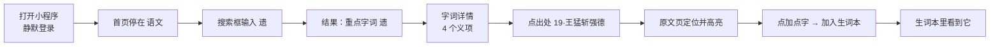

# 学科小程序 · 页面与交互设计（首期：语文 / 文言文搜索）

版本 0.1 · 2026-10-05 · 状态：待确认。视觉稿在阶段 1 用 Claude Design 出，本文档定结构和交互。

## 1. 信息架构

底部三个 tab：**首页**、**生词本**、**我的**。首页就是当前科目的功能页，科目用顶部的切换条切换。每个模块（文言文、古诗词……）放在各自的分包里。

层级是三层：科目（顶部切换）→ 模块（首页卡片）→ 模块内的页面。

```mermaid
flowchart TD
  A[首页 tab<br/>科目切换条 + 搜索 + 模块卡片] -->|文言文卡片| B[文言文模块页<br/>热门字 + 专题入口]
  A -->|科目内搜索| C
  A -->|继续学习| F
  A -->|最近查过| D
  B -->|只搜文言文| C[搜索结果<br/>可按模块筛选]
  B -->|热门字| D[字词详情<br/>一字多义导图]
  B -->|100 篇原文| E[篇目列表]
  B -->|专题| H[通假字 · 活用 · 异义<br/>现代文→文言对照]
  C -->|点字词| D
  C -->|点句子| F[原文阅读<br/>定位到该句]
  D -->|点出处| F
  E --> F
  F -->|点加点字| G[半屏释义卡]
  G -->|看导图| D
  H --> D
  H --> F
  V[生词本 tab] -->|字词| D
  V -->|句子| F
  M[我的 tab] --> N[搜索历史]
  M --> P[隐私说明 / 关于]
  N --> D
```

## 2. 主流程

查一个字的完整路径，也是验收时要走的路径：

## 3. 通用规范

| 项 | 约定 |
|---|---|
| 文言文字 | 楷体，字号比正文大一级，行距宽松 |
| 加点字 | 朱红色加着重号（沿用课本习惯），可点击 |
| 译文 | 黑体小一号，次要颜色，紧跟在原句下方 |
| 义项颜色 | 每个字的义项按顺序取 8 种固定颜色，同一个字在各页面颜色一致 |
| 出处 | 统一写成「19·王猛斩强德」，可点击 |
| 加载 | 列表用骨架屏；按钮操作用轻提示，不用全屏 loading |
| 出错 | 页面内显示「加载失败」和重试按钮，不弹窗 |
| 返回 | 使用系统导航栏返回；从原文页返回字词详情时保持原来的滚动位置 |

## 4. 逐页说明

### 4.1 首页（tab）

- **布局**：从上到下四块，分别是科目切换条、科目内搜索框、模块卡片（2 列）、继续学习。
- **科目切换条**：语文、数学、英语、物理、化学横排，代替导航栏标题。当前科目字号更大并带下划线；未上线的科目颜色变浅。
- **搜索框**：占位文字「在语文里搜：字、词、句子」。点击进入搜索结果页，范围是当前科目的全部模块。
- **模块卡片**：已上线的模块用主色实心大卡，占整行，写明内容量（「100 篇原文对译 · 121 个重点字」）；未上线的用灰色小卡，标「即将上线」。上线的模块多了以后，全部改为 2 列等大卡片。
- **继续学习**：上次读到的篇目一行，最近查过的字词一排。
- **交互**
  - 点已上线的科目：整页内容切换为该科目，并记住这个选择。
  - 点未上线的科目或模块：轻提示「正在准备中」，页面不变。
  - 点模块卡片进入模块页；点「继续学习」回到上次的位置。
- **状态**：没有学习记录时隐藏「继续学习」。科目和模块清单加载失败时，显示重试按钮。

### 4.2 文言文模块页

- **布局**：搜索框固定在顶部；下面依次是热门字、三个入口卡片。
- **元素**
  - 搜索框，占位文字「只在文言文里搜」。
  - 热门字 12 个，按出现次数排，字下方小字标次数。
  - 入口卡片：100 篇原文、通假字·活用·异义、现代文→文言对照。
- **交互**：点搜索框进入搜索结果页并弹出键盘；点热门字直接进字词详情。

### 4.3 搜索结果

- **布局**：顶部搜索框（带清除按钮）；其下是模块筛选条；再下面是结果分组，每组一个小标题和条数。
- **模块筛选条**：全部、文言文、古诗词、阅读理解……从首页进来默认选「全部」，从某个模块页进来默认选中那个模块。未上线的模块用虚线框，不可点。选「全部」且有多个模块有结果时，结果先按模块分段，每段只显示前 3 条和「查看该模块全部结果」。
- **文言文的分组与单条内容**

| 分组 | 单条显示 | 点击去向 |
|---|---|---|
| 重点字词 | 大字、义项概要（如「赠送；丢失的东西；遗漏」）、出现次数 | 字词详情 |
| 现代文 → 文言 | 文言字、匹配的义项、一条例句和译文 | 字词详情，并滚动到该义项 |
| 原文句子 | 原句（高亮关键词）、译文、出处 | 原文阅读并定位 |
| 译文句子 | 译文（高亮关键词）、对应原句、出处 | 原文阅读并定位 |

- **交互**：输入停顿 300ms 自动搜索；每组默认 5 条，点「展开全部 N 条」加载其余；没有结果的分组不显示。
- **状态**
  - 未输入：显示搜索历史（最近 10 条）和热门字。
  - 无结果：「这 100 篇里没有找到“××”。试试只输入一个字。」并给出热门字。
  - 请求失败：重试按钮。

### 4.4 字词详情（一字多义导图）

- **布局**：顶部信息区；下面是纵向的树形导图。
- **顶部**：大字、「32 处 · 8 个义项」、收藏按钮（星形，已收藏为实心）。
- **导图**：左侧一条竖线作主干，每个义项是一个带颜色的节点，节点内有义项、词性读音、识别提示、例句数。节点下方缩进排列例句卡片。
- **例句卡片**：原句（该字带着重号）、译文、标签「此处：赠送」、出处、右侧收藏句子的小按钮。
- **交互**
  - 义项节点可折叠；例句超过 4 条时先显示 4 条，点「展开其余 N 条」。
  - 点出处进原文阅读并定位。
  - 顶部提供义项快速跳转条（横向滚动的彩色小标签），点一下滚到对应义项。
  - 收藏成功轻提示「已加入生词本」，再点取消。
- **状态**：字不在词库里时显示「这个字还没有收录」，并给出包含它的原文句子（走搜索接口）。

### 4.5 篇目列表

- **布局**：顶部筛选输入框；下面是 100 篇的列表。
- **单条**：序号、篇名、出处（朝代 作者《书名》）、加点字数量。
- **交互**：输入篇名关键字即时筛选；点击进入阅读页。记住上次读到的篇目，列表里标「上次读到」。

### 4.6 原文阅读

- **布局**：标题区（篇名、出处）；正文区（原文与译文逐句交替）；篇末区（本篇加点字、注释）；底部上一篇 / 下一篇。
- **交互**
  - 点加点字弹出半屏释义卡。
  - 导航栏右侧开关「隐藏译文」。隐藏后点某句只显示这一句的译文，再点收起。
  - 从别处带着句子编号进来时，自动滚动到该句并高亮 2 秒。
  - 长按任一句，出现「加入生词本」。
- **半屏释义卡**：大字、此处意思、所属义项（带颜色）、该字的其他义项概要；两个按钮「看导图」「加入生词本」。点卡片外或下滑关闭。

### 4.7 专题页（通假字 · 活用 · 异义 · 对照表）

- **布局**：顶部四个分段标签；每个标签下是一张列表。
- **内容**：通假字（本字、通什么、意思、例句）；词类活用（字、类型、意思、例句）；古今异义（词、文中意思、今天意思、例句）；现代文→文言（现代文说法、对应的文言字）。
- **交互**：例句的出处可点；对照表里的文言字可点进字词详情。

### 4.8 生词本（tab）

- **布局**：顶部分段「字词 / 句子」和数量；下面是列表。
- **字词项**：大字、义项概要、加入日期。**句子项**：原句、译文、出处。
- **交互**：点击进入详情或原文；左滑出现删除；删除后底部提示条「已删除，撤销」保留 3 秒。
- **状态**
  - 空：「还没有生词。查字时点星形就能加进来。」加一个「去搜索」按钮。
  - 登录失败：「登录失败，暂时看不到生词本」和重试按钮。

### 4.9 我的（tab）

- **布局**：资料区、功能列表。
- **资料区**：头像、昵称。未填写时显示默认头像和「点击设置头像昵称」，使用微信的头像昵称填写能力，用户可以不填。
- **列表**：搜索历史、隐私说明、关于。
- **搜索历史页**：按时间倒序，单条可左滑删除，右上角清空（清空前在页面内二次确认）。
- **关于页**：数据来源说明、版本号、意见反馈方式。

## 5. 接口与页面的对应

| 页面 | 接口 |
|---|---|
| 启动 | `POST /auth/wx-login` |
| 首页 | `GET /subjects`（科目及各自的模块清单、是否上线）、`GET /me/recent`（上次读到、最近查过） |
| 文言文模块页 | `GET /wenyan/hot` |
| 搜索结果 | `GET /search?subject=yuwen&module=&q=`（按模块返回，各模块自带分组） |
| 字词详情 | `GET /wenyan/entries/:word` |
| 篇目列表 | `GET /wenyan/articles` |
| 原文阅读 | `GET /wenyan/articles/:id` |
| 专题页 | `GET /wenyan/topics/:type` |
| 生词本 | `GET / POST / DELETE /me/favorites` |
| 我的 | `PUT /me/profile`、`GET / DELETE /me/history` |

## 6. 留给视觉稿决定的事

- 整体配色与五个科目各自的识别色。
- 字词详情导图在小屏上的节点样式和连线画法。
- tabBar 图标。
- 着重号在小程序里的实现效果（`text-emphasis` 在部分机型不支持时，改用字下方的小圆点伪元素）。
